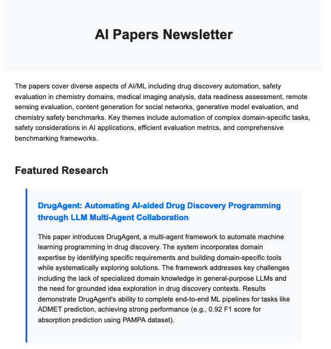
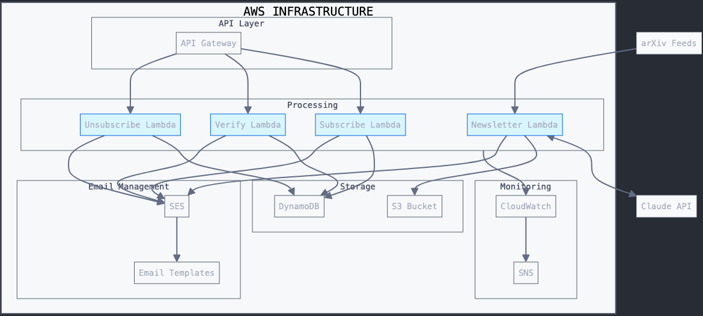

# AI Research Paper Newsletter

Automatically generates and sends newsletters about AI research papers using AWS Lambda and OpenAI. Create your own prompts that fit your desired use case.

[Sign up here](https://wesleypasfield.com/aipapers/) for  the original version.

Here's an [article](https://substack.com/home/post/p-152582033) I put together that walks through the full end-to-end building process.

## Features

- 🤖 Uses OpenAI models to evaluate and summarize AI research papers
- 📊 Customizable paper evaluation criteria
- 📧 Automated email delivery via AWS SES
- ✅ Double opt-in subscriber management
- 📈 Built-in analytics and monitoring

Keep in mind there might be some required customization in your account, but this should get you really far along the way

## Newsletter Example

Below is an example of the newsletter final output:



## Architecture

The system consists of several key components:

- Paper Analyzer: Evaluates papers using OpenAI
- Newsletter Generator: Creates formatted newsletters
- Email Management: Handles subscriptions and delivery
- Monitoring: Tracks delivery and engagement metrics



## Prerequisites

- AWS Account with SES in production mode
- OpenAI API Key
- Python 3.11+
- AWS SAM CLI
- Verified SES sender email or domain

## Setup

1. **Configure AWS Credentials**
   ```bash
   aws configure
   ```

2. **Create Required Secrets**
   ```bash
   export OPENAI_PAPER_NEWSLETTER_KEY="sk-proj-your-key-here"

   aws secretsmanager create-secret \
       --name openai/paper_newsletter_key \
       --secret-string "{\"openai_key\":\"$OPENAI_PAPER_NEWSLETTER_KEY\"}"
   ```

The Lambda reads the secret from Secrets Manager at runtime. For local testing, either keep `OPENAI_PAPER_NEWSLETTER_KEY` exported or set `OPENAI_SECRET_NAME=openai/paper_newsletter_key`.

3. **Configure Deployment**

   - Copy samconfig.example.toml to samconfig.toml
   - Keep `TrackingDomainName` empty unless the SES tracking domain DNS and proxy/CDN are already configured.
   - Update the remaining values for your account.

   ```bash
   cp samconfig.example.toml samconfig.toml
   # Edit samconfig.toml with your values
   ```

4. **Deploy Infrastructure**
   ```bash
   sam build
   sam deploy --guided
   ```

## Configuration

### Paper Evaluation

The system uses two key prompts that can be customized:

1. EVAL_PROMPT: Determines how papers are scored
2. NEWSLETTER_PROMPT: Controls newsletter formatting

Example evaluation criteria:
```python
EVAL_PROMPT = """
You are evaluating academic papers for an expert specializing in:
1. Practical LLM/Generative AI regulation
2. Societal and economic impacts
3. Technical implementation
...
"""
```

### Email Templates

Templates can be customized in the CloudFormation template:
- Verification Email
- Welcome Email
- Newsletter Template
- Unsubscribe Confirmation

## API Endpoints

The system exposes several REST endpoints:

- POST /subscribe: Subscribe new email
- GET /verify: Verify subscription
- GET /unsubscribe: Show a confirmation page
- POST /unsubscribe: Confirm removal using the subscriber-specific token
- GET /metrics: Subscriber metrics, protected by AWS IAM authorization
- POST /bulk-verify: Send verification reminders, protected by AWS IAM authorization

## Monitoring

Built-in CloudWatch dashboard provides metrics for:
- Email delivery rates
- Bounce/complaint rates
- Lambda execution metrics
- Paper processing statistics

## Development

### Adding New Features

1. Update SAM template
2. Add required Lambda functions
3. Update email templates if needed
4. Test locally
5. Deploy changes
6. Configure needed S3 resourcs for website hosting/landing page if interested

## Contributing

1. Fork the repository
2. Create a feature branch
3. Submit a pull request

## Security

Review the security checklist before deployment:
- SES domain verification
- API authentication
- IAM permissions
- Rate limiting
- CORS configuration

## Testing

The `EmailTestMode` and `EmailTestAddress` parameters in the SAM configuration enable testing. If email test mode is set to true, newsletter delivery is limited to `EmailTestAddress`.

Run the local regression tests and infrastructure validation before deployment:

```bash
python -m unittest discover -s tests -v
python test_improvements.py
sam validate --lint --template-file template.yaml
```

Some AWS account setup remains outside this template, particularly SES production access and DNS for domain identity or custom click tracking.
