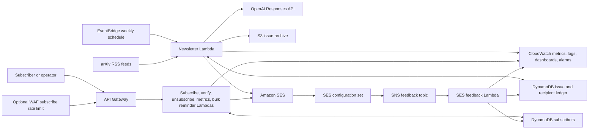
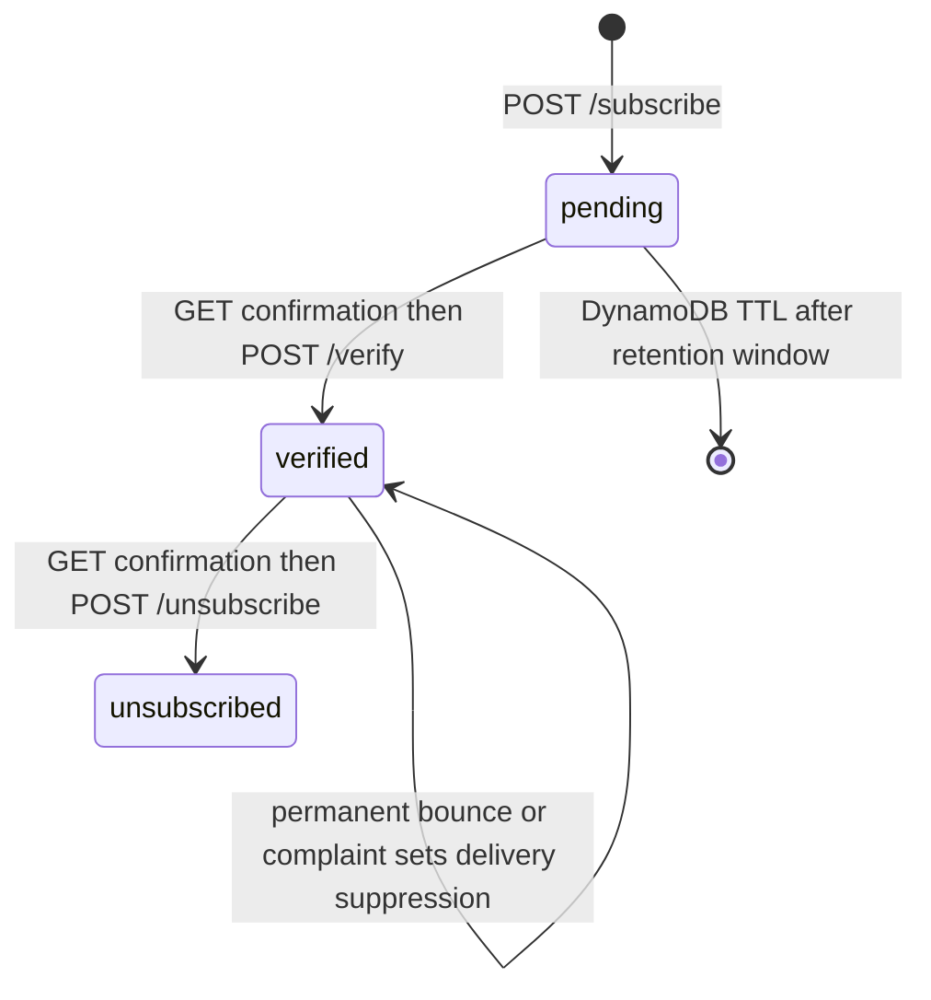

# AI Research Paper Newsletter

An AWS SAM application that finds recent AI research, ranks it against an editorial rubric, writes a grounded weekly digest with OpenAI models, and delivers it through Amazon SES.

[See the original newsletter](https://wesleypasfield.com/aipapers/) or read the [build article](https://substack.com/home/post/p-152582033).

> [!CAUTION]
> The production defaults enable two automated email paths. The newsletter schedule submits a real issue every Tuesday at 12:00 UTC, and the hourly reminder job can send one verification reminder after 48 hours. For a first deployment, keep both schedule flags set to `false` in `samconfig.toml`, keep `EmailTestMode="true"`, deploy, inspect a generated preview, then enable each schedule deliberately.

`EmailTestMode` limits newsletter recipients to `EmailTestAddress`. It does not prevent subscription verification messages, scheduled verification reminders, or confirmed bulk reminders.

## What it does

- Reads eight first-party arXiv category feeds.
- Screens titles for recall, scores abstracts with deterministic weights, and ranks the combined candidate pool.
- Treats loop engineering, agent evaluation, and optimization as the highest editorial priority.
- Produces grounded summaries and an issue overview with explicit output contracts.
- Uses double opt-in verification and token-confirmed unsubscribe flows.
- Keeps durable issue, recipient submission, and SES delivery state so a retry does not blindly resend.
- Records bounce and complaint feedback and suppresses unsafe recipients.
- Provides CloudWatch dashboards, alarms, and retained logs for operator review.

## Architecture



The Mermaid diagram above is the current architecture source. The legacy PNG in `assets/` is retained for repository history.

## Editorial and model pipeline

The default search covers `cs.AI`, `cs.LG`, `cs.CL`, `cs.SE`, `cs.MA`, `cs.CY`, `cs.HC`, and `stat.ML`. Ranking happens after feed results are combined and deduplicated, which avoids favoring whichever feed loads first.

Each healthy weekly run follows this invariant:

1. Search the last 7 days.
2. Expand to 14 days, then 30 days, when the first window has too few qualified papers.
3. Use the best available valid candidates when the feeds and model pipeline are healthy.
4. Record partial feed or paper-evaluation failures as degraded metadata when enough valid candidates remain. Raise `IssueGenerationFailed` and send nothing when all feeds fail, a complete model stage fails, synthesis fails, or fewer than three valid papers remain. The system does not fabricate or send an empty issue.

The defaults select at least three and up to seven featured papers, plus up to three additional papers. Title screening has a `0.35` recall floor. Abstract ranking uses `0.60` as the preferred relevance threshold, then the weekly fallback can choose the best valid candidates when fewer than three clear it. The score weights direct fit at 40%, evidence quality at 25%, production transferability at 20%, domain-expert relevance at 10%, and novelty at 5%.

| Stage | Primary model | Reasoning | Purpose |
| --- | --- | --- | --- |
| Title screen | `gpt-5.6-luna` | none | Cheap, recall-oriented filter |
| Abstract evaluation | `gpt-5.6-luna` | low | Structured scoring against the editorial rubric |
| Featured-paper summary | `gpt-5.6-luna` | medium | Grounded contribution, evidence, relevance, and limitation |
| Issue overview | `gpt-5.6-luna` | medium | Synthesis across selected summaries |

Retry routing moves first to `gpt-5.6-sol`, then to `gpt-5.5` after retryable API failures or invalid model output. Authentication, authorization, and other non-retryable client errors fail the stage immediately.

The newsletter does not load personal writing skills such as `agentic-writer` at runtime. Its voice and content rules live in the prompts in `functions/newsletter_generator.py` and `functions/paper_analyzer.py`.

## Subscriber and delivery state



The subscribers table keeps one normalized email record and a status GSI. Pending records receive a `pending_expires_at` TTL, 30 days by default. DynamoDB TTL cleanup is asynchronous, so an expired record can remain visible for a while after its deadline.

The issue ledger uses `issue_id` and `recipient_id` keys. The `ISSUE` record coordinates generation and submission. Hashed recipient records track attempted, accepted, delivered, bounced, complained, rejected, or rendering-failed states. Recipient delivery records expire after 180 days; issue records expire after one year. Issue content is archived in a versioned, private S3 bucket.

An SES `accepted` result means SES accepted the submission request. It does not prove mailbox delivery. Delivery, bounce, complaint, reject, and rendering-failure events arrive later through the SES configuration set and SNS feedback path. Newsletter outcomes update recipient ledger records; verification and reminder outcomes update delivery fields on subscriber records.

## Prerequisites

- An AWS account and credentials allowed to deploy SAM resources
- AWS SAM CLI
- Python 3.11
- An OpenAI API key
- An SES-verified sender or domain in the deployment Region
- SES production access before sending outside the SES sandbox

## Safe first deployment

1. Install and validate locally.

   ```bash
   python3.11 -m venv .venv
   source .venv/bin/activate
   python -m pip install -r requirements.txt
   python -m pytest -q
   sam validate --lint --template-file template.yaml
   sam build --parallel
   ```

2. Create the OpenAI secret. Avoid putting the key in `samconfig.toml` or source control.

   ```bash
   export OPENAI_PAPER_NEWSLETTER_KEY="replace-me"
   aws secretsmanager create-secret \
     --name openai/paper_newsletter_key \
     --secret-string "{\"openai_key\":\"$OPENAI_PAPER_NEWSLETTER_KEY\"}"
   unset OPENAI_PAPER_NEWSLETTER_KEY
   ```

   If the secret already exists, use `aws secretsmanager put-secret-value` instead of creating a second secret.

3. Copy the safe example configuration.

   ```bash
   cp samconfig.example.toml samconfig.toml
   ```

   Replace every example domain and address. The example keeps newsletter and reminder schedules disabled, enables newsletter test mode, and leaves WAF disabled.

4. Review the change set and deploy.

   ```bash
   sam build --parallel
   sam deploy --guided
   ```

5. Confirm the SNS alarm subscription sent to `AlertEmail`, verify the SES identity or domain, inspect the stack outputs, and follow the preview runbook in [docs/operations.md](docs/operations.md).

6. Enable `VerificationReminderScheduleEnabled` only after reviewing the pending subscriber population. Enable `NewsletterScheduleEnabled` only after a successful preview and test-address submission.

CloudFormation manages the active newsletter template as `${stack}-newsletter-template-v2`. The suffix avoids colliding with a legacy template that older deployments created at runtime. After the new stack version has delivered successfully, the old `${stack}-newsletter-template` can be removed manually if no other workload uses it.

## Important parameters

| Parameter | Default | Meaning |
| --- | --- | --- |
| `NewsletterScheduleExpression` | `cron(0 12 ? * TUE *)` | Weekly generation and confirmed submission schedule, in UTC |
| `NewsletterScheduleEnabled` | `true` | Enables the real automated newsletter path |
| `VerificationReminderScheduleExpression` | `rate(1 hour)` | Pending-subscriber reminder check |
| `VerificationReminderScheduleEnabled` | `true` | Enables one-time reminders after 48 hours |
| `EmailTestMode` | `false` | Restricts newsletter delivery to the test address |
| `SubscribeCooldownSeconds` | `900` | Cooldown before another verification request for an address |
| `PendingSubscriberTtlDays` | `30` | Pending-record retention before TTL cleanup |
| `BulkVerificationMaxBatch` | `100` | Maximum recipients in one confirmed bulk reminder run |
| `EnableApiWaf` | `false` | Adds the optional regional WAF subscribe rate limit |
| `SubscribeWafRequestsPerFiveMinutes` | `1000` | Per-IP WAF limit scoped to `POST /subscribe` |
| `OpenAIModelCheap` | `gpt-5.6-luna` | Title screen model |
| `OpenAIModelExpensive` | `gpt-5.6-luna` | Abstract, summary, and overview model |
| `OpenAIModelFallback` | `gpt-5.6-sol` | First rate-limit fallback |
| `OpenAIModelEmergency` | `gpt-5.5` | Emergency rate-limit fallback |

The API always applies stage and method throttles. WAF is optional because it adds cost. Its default limit is intentionally high enough to reduce obvious abuse without blocking normal subscription traffic.

Keep `TrackingDomainName` empty unless its DNS and proxy or CDN path are already configured. The stack does not provision that external tracking path.

## API surface

| Method and path | Authorization | Behavior |
| --- | --- | --- |
| `POST /subscribe` | Public | Creates or refreshes a pending double-opt-in request |
| `GET /verify` | Public token | Shows a confirmation page without changing state |
| `POST /verify` | Public token | Confirms a valid pending subscriber |
| `GET /unsubscribe` | Public token | Shows a confirmation page without changing state |
| `POST /unsubscribe` | Public token | Changes the subscriber to unsubscribed |
| `GET /metrics` | AWS IAM | Returns complete counts for verified, pending, and unsubscribed states |
| `POST /bulk-verify` | AWS IAM | Previews or confirms a bounded reminder campaign |

The bulk endpoint defaults to a dry run. A real send requires `confirm_send=true` and a nonempty `campaign_id`. It excludes requests older than 30 days, skips subscribers whose reminder was already accepted unless `force=true`, and applies the configured batch cap. Preview, compare counts, then confirm the same options. See [docs/operations.md](docs/operations.md).

## Monitoring and operations

CloudWatch retains each Lambda log group for 30 days. The stack also creates:

- Lambda error alarms for every function
- An alarm when the automated schedule produces no `IssueReady` metric for seven days
- An alarm for `IssueGenerationFailed`, `IssueSubmissionFailed`, or `IssueSubmissionPartial`
- SES newsletter and verification bounce and complaint alarms
- Newsletter and verification dashboards

Issue metrics use the `Newsletter/Issues` namespace. A completed submission means recipient requests were accepted by SES. Use the SES feedback ledger and `AWS/SES` delivery metrics to assess later delivery outcomes.

The detailed [operations runbook](docs/operations.md) covers previews, confirmed sends, subscriber metrics, bulk reminders, failure triage, rollback, and retained-data behavior.

## Privacy and security

- Subscriber email addresses, status history, and tokens are stored in DynamoDB.
- Newsletter recipient ledger keys use deterministic email hashes rather than raw addresses.
- Logs use short subscriber identifiers in send and reminder paths, but operators should still treat logs and failure payloads as sensitive.
- DynamoDB point-in-time recovery is enabled and both tables are retained on stack deletion or replacement.
- S3 blocks all public access, uses bucket-owner-enforced ownership, encryption at rest, versioning, and retained deletion policies.
- Public state-changing verification and unsubscribe actions require a POST after the tokenized confirmation page.
- Metrics and bulk reminder endpoints require AWS IAM authorization.
- The active SES newsletter template is controlled by CloudFormation. Lambda roles do not have template mutation permission.

Review CORS and WAF policy against your own landing-page topology. The public API currently allows any origin because subscription links and forms may be hosted separately.

## Development and CI

Run the same high-signal checks used by GitHub Actions:

```bash
python -m pytest -q
ruff check functions tests test_improvements.py --select E9,F63,F7,F82
sam validate --lint --template-file template.yaml
sam build --parallel --template-file template.yaml
pip-audit --strict --requirement requirements.txt
```

The workflow tests Python 3.11, checks high-confidence Ruff failures, validates and builds SAM, and audits the fully pinned deployment dependency closure.

## Known limitations

- SES production access, identity verification, DMARC policy, and any custom click-tracking proxy require account-level work outside this stack.
- Unsubscribe preserves the subscriber record and bounded history. The project has no public erasure endpoint, so a verified manual process is required for a deletion request.
- The stack preserves the historical `${stack}-newsletters` bucket name to avoid replacing production archives. A stack name must still be unique enough to avoid global S3 name collisions in a new account.
- WAF is opt-in and incurs AWS charges.
- DynamoDB TTL deletion is eventual.
- SES event delivery is asynchronous. Recent submissions can remain in `accepted` state before a later delivery event arrives.
- The legacy architecture PNG and legacy runtime-created SES template can remain after an upgrade. Mermaid and the `-v2` CloudFormation resource are authoritative.

## License

[MIT](LICENSE.md)
